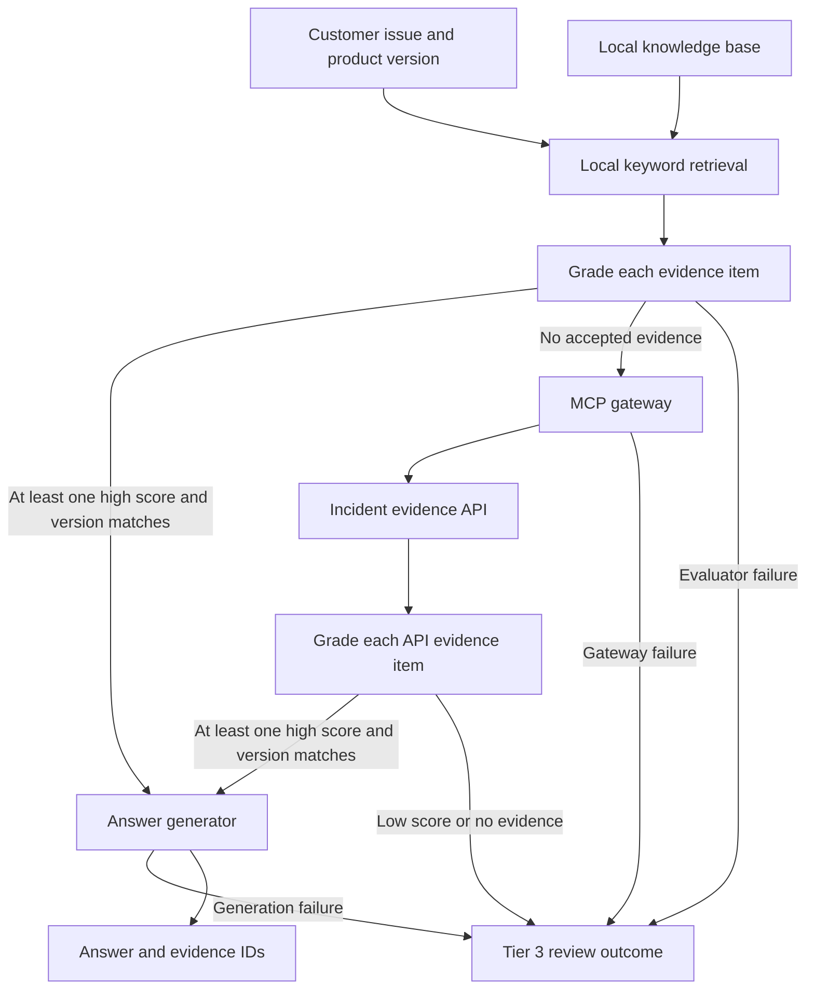

# Corrective RAG: technical support and incident triage

## Use case

A customer reports an error and supplies the product version. A support assistant searches local knowledge articles, evaluates each excerpt, and answers only when there is sufficiently strong, version-matched evidence. If local evidence is weak or ambiguous, it queries an incident evidence API through an MCP gateway and grades the new evidence. If that is also insufficient, it returns a Tier 3 human-review outcome instead of generating an answer.

The example uses fictional API connection-pool incidents. For example, `API-503 connection pool exhausted` is documented locally for version 2.0, in the gateway fixture for version 3.0, and not documented for version 4.0.

## System design



The confidence threshold defaults to 0.8. Anything below the threshold, including ambiguous or medium results, triggers the gateway if no other local item passes. Exact version equality is enforced in code in addition to the evaluator's version assessment. Only accepted evidence reaches generation. The outcome `human` is a **handoff recommendation in the CLI**; this example does not create a ticket or notify an engineer.

## Setup and demo

Requires Python 3.10+. From this folder:

```bash
python3 -m venv .venv
source .venv/bin/activate
pip install -e .
crag 'API-503 connection pool exhausted' --version 2.0
crag 'API-503 connection pool exhausted' --version 3.0
crag 'API-503 connection pool exhausted' --version 4.0
python -m unittest discover -s tests -v
python evaluation/evaluate.py
```

By default the evaluator is a simple deterministic word-overlap heuristic, the gateway reads a fixture, and the generator copies accepted evidence. This gives a free, reproducible demo; it is **not** a trained evaluator or a real technical accuracy check. No LLM or external API is called in this mode.

## Using models and MCP

Set `OPENAI_API_KEY` and optionally `OPENAI_BASE_URL` for a trusted OpenAI-compatible endpoint. Pass `--evaluator-model YOUR_SMALL_MODEL` to use a model evaluator and `--answer-model YOUR_GENERATION_MODEL` for answer generation. Both adapters use the same endpoint configuration; the evaluator endpoint must support JSON-object responses. A fine-tuned Llama 3 8B is an example of a model you could serve; this project does not include or fine-tune it. Model inference may send issue and evidence data to the configured provider and incur cost.

To use the MCP gateway, set `INCIDENT_API_URL` to a trusted HTTPS endpoint and optionally `INCIDENT_API_TOKEN`, then pass `--gateway mcp`. The gateway starts as a local stdio MCP server and calls that API with `issue` and `version` query parameters. It expects a JSON array with the same fields as [gateway.json](data/gateway.json): `id`, `version`, `title`, `text`, and `source`. The included fixture is not a live API. Configure an actual compatible API to exercise this path.

## Evaluation and limits

[data/evaluation.json](data/evaluation.json) contains five fictional cases, with expected route and evidence ID. The offline evaluation measures the fraction with the expected route and evidence. Unit tests verify routing, version mismatch, weak evidence, empty results and failure handling. These are small smoke checks, not an accuracy benchmark. Build a held-out, expert-labeled dataset with incorrect and outdated evidence, borderline scores, conflicting evidence, and realistic incidents; measure false-acceptance, escalation, retrieval and answer-grounding rates separately. Calibrate thresholds on that data.

A model's confidence and its assessment of technical accuracy are not proof of correctness; it cannot verify claims independently from the text. This demo does not resolve conflicting evidence, verify generated citations or guarantee that accepted evidence fully answers an issue. Local retrieval is keyword overlap, not a vector database. Treat outputs as decision support, not autonomous operational actions. The example has no authentication, tenant isolation, authorization or real ticket integration. Do not send confidential or sensitive incident data to unapproved endpoints.
