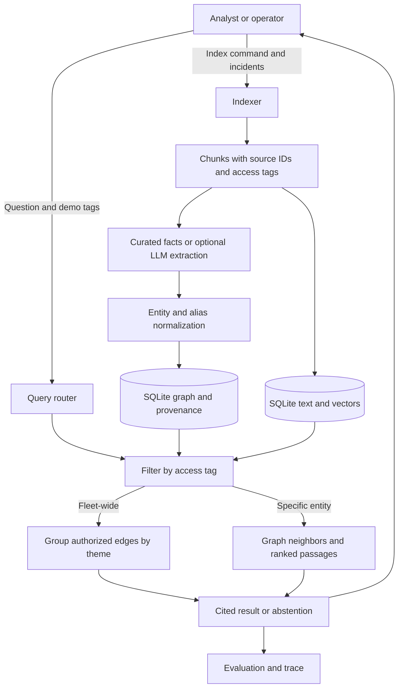

# Fleet GraphRAG: systemic failure themes

A small, runnable learning project for an incident analyst asking: **“What failure themes affect multiple services?”** It builds a source-linked graph from fictional incident reports, finds fleet-wide themes or service-specific evidence, and returns cited results or abstains when no evidence is found.

## System design



1. **Indexer:** An operator supplies JSON incidents. Each short incident becomes a chunk, with its source ID and access tag. Curated or optionally LLM-extracted triples become normalized graph edges. A replacement SQLite index is built synchronously and installed only after a successful build.
2. **Query router and filter:** The analyst supplies a question and demo tags. The router picks global or local search using simple keywords; `--mode` overrides it. SQLite filters chunks and edges before traversal or aggregation.
3. **Global search:** Authorized relationships are grouped by failure theme. A theme qualifies when it appears across at least two services and two incidents. Each deterministic summary includes its supporting incident IDs.
4. **Local search:** The engine finds an entity's one-hop relationships and ranks source passages using keyword overlap and vector similarity. Without an entity match it searches authorized passages. The default vectors are hashed word counts; optional embeddings support semantic similarity.
5. **Response and trace:** The CLI returns a cited result or abstains if it finds no evidence. It records query elapsed time, authorized chunk count and runtime model calls. Evaluation runs separately.

## Run

Python 3.10+; run these commands from this folder:

```bash
python3 -m venv .venv
source .venv/bin/activate
pip install -e .
fleet-graphrag index
fleet-graphrag ask 'What systemic themes occur across the fleet?' --tag ops
fleet-graphrag ask 'What happened to checkout?' --tag ops
fleet-graphrag ask 'What happened to billing?' --tag ops
fleet-graphrag ask 'What happened to billing?' --tag restricted
python -m unittest discover -s tests -v
python evaluation/evaluate.py
```

The billing question with `ops` abstains because its incident is tagged `restricted`. Repeat `--tag` for multiple tags. Use `--mode global` or `--mode local` to override routing; use `--db PATH` to choose the SQLite index.

## Optional models

```bash
pip install -e '.[models]'
# Semantic vector search; the model downloads on first use.
fleet-graphrag index --embedding-model sentence-transformers/all-MiniLM-L6-v2
# Optional LLM relationship extraction; incident text is sent to the configured API.
export OPENAI_API_KEY='your-key'
fleet-graphrag index --extract-model YOUR_MODEL --embedding-model sentence-transformers/all-MiniLM-L6-v2
```

`OPENAI_BASE_URL` can identify a trusted OpenAI-compatible endpoint supporting JSON-object responses. Model extraction returns service–failure triples that require review. Malformed output aborts the rebuild and preserves the previous index. Alias normalization uses a small explicit dictionary. The embedding model must be available when querying; its name is stored in SQLite. Downloads and API calls require network access and may incur cost. Runtime answers are deterministic even when models were used during indexing. Optional model integrations have not been tested against external services.

## Evaluation and boundaries

The [sample incidents](data/incidents.json) contain text, source IDs, access tags and curated triples. The [evaluation cases](evaluation/cases.json) cover themes, entity lookup, restricted evidence and abstention. The evaluation reports a case pass rate; these examples are smoke checks, not a production benchmark. The offline tests also cover failed index rebuilds and access filtering.

**Access tags are a demonstration, not authentication:** the CLI caller can choose any tag and can read the SQLite file. A deployed system needs trusted identity, server-side authorization and storage protection. Summaries must respect the user's permissions; this prototype derives summaries after filtering rather than mixing evidence from different tags.

The default hashed vectors are lexical, not semantic; opt in to the embedding model for semantic similarity. SQLite scans the vectors in memory, suitable only for small collections. The router is rule-based, the theme groups are not hierarchical graph communities, and summaries are deterministic rather than LLM map-reduce summaries. There is no runtime LLM generation, time-window or trend analysis, or authenticated identity. Global search reports all qualifying themes rather than narrowing to a specific topic. No-evidence abstention is not a calibrated confidence guarantee. Citations are source IDs and are not independently verified for claim-level support; relationships and input records can be incorrect. Correlation does not prove root cause.

Before real use, build a reviewed held-out dataset and measure theme precision and recall, access leakage, citation support, abstention quality, latency and model cost. Add robust entity resolution, conflict handling, authorization, prompt-injection defenses and operational review.

## Project files

- [engine.py](src/fleet_graphrag/engine.py): indexing, graph search, filtering and routing.
- [models.py](src/fleet_graphrag/models.py): optional LLM extraction; [cli.py](src/fleet_graphrag/cli.py): command-line entry point.
- [data](data/): sample incidents; [evaluation](evaluation/): cases and runner; [tests](tests/): offline tests.
