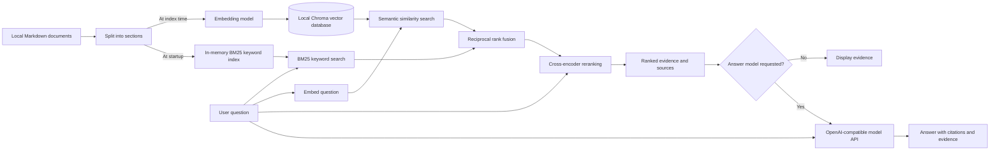

# Hybrid local RAG: IT support assistant

**Problem:** Employees describe IT problems in different words, but support articles also contain precise error codes. Find the right troubleshooting article for both kinds of question and use it as evidence for an answer.

The pipeline splits the sample Markdown into sections, stores sentence embeddings in a persistent local Chroma vector database, retrieves candidates using BM25 keyword search and semantic similarity, combines rankings with reciprocal rank fusion, and reranks candidates with a cross-encoder. The optional answer step sends the question and ranked excerpts to an OpenAI-compatible API. The default command displays evidence without calling an LLM.

## System design



The vector database persists locally. The BM25 index is rebuilt in memory when the program starts. The model API is used only when `--model` is provided.

## Run

Python 3.10+; commands run from this directory. The first run downloads embedding and reranking models from Hugging Face and may take several minutes. Later runs can use the model cache offline.

```bash
python3 -m venv .venv
source .venv/bin/activate
pip install -e .
hybrid-rag index
hybrid-rag ask 'How do I fix VPN-104?'
hybrid-rag ask 'My computer loses power quickly'
# Optional answer generation (requires a configured API key and supported model)
export OPENAI_API_KEY='your-key'
hybrid-rag ask 'How do I fix VPN-104?' --model YOUR_MODEL
```

Use `--documents PATH` and `--db PATH` before the subcommand. Add UTF-8 Markdown files with `##` headings to the document directory and rerun `index` after edits. Indexing replaces the existing `support` collection in the chosen database; use a dedicated directory. Search detects changed files and embedding model names and asks for a rebuild. BM25 is rebuilt in memory at startup. Models run locally, but initial downloads need network access. The answer model receives retrieved excerpts and the question; consider data sensitivity before enabling it.

## Tests and evaluation

```bash
python -m unittest discover -s tests -v
python evaluation/evaluate.py --k 3
```

The evaluation measures retrieval recall@k against five labeled examples, including exact codes and paraphrases. It requires the built index and local models. These examples are smoke tests, not a representative benchmark. Add held-out reviewed questions, evidence labels, unanswerable cases and answer-grounding checks before assessing quality. Semantic search always returns nearest neighbors: no relevance threshold or reliable abstention is implemented. Reranker scores are not probabilities, and generated citations are not verified. This single-user learning project has no authentication or document-level access control.
