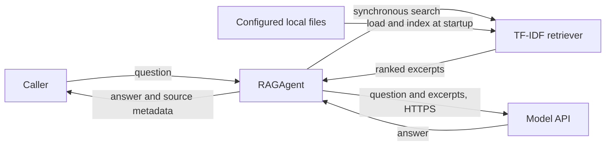

# Simple RAG Agent

A small Python component that answers questions using explicitly configured local documents. Retrieval-augmented generation (RAG) means finding relevant text first and giving it to a language model as context. This project uses a fixed retrieval-and-answer workflow; it does not autonomously execute tools or take actions.

## 1. Scope and assumptions

- One trusted operator runs a local process against a small document collection. TXT, Markdown and text-based PDF files are supported; scanned PDFs need OCR first.
- The default answer adapter sends the question and retrieved excerpts to an OpenAI-compatible API. Set `OPENAI_BASE_URL` only to a trusted compatible provider. Check its data handling before sending confidential content.
- Documents are loaded and indexed in memory on each run. There is no server, authentication, user isolation, persistent index, or background refresh. Restart or construct a new retriever after documents change.
- Retrieval uses TF-IDF keyword similarity, not embeddings. It is simple, free and deterministic, but can miss synonyms or retrieve irrelevant text that shares common words. A nonzero score is not proof of relevance.

## 2. Design and request flow



1. The caller explicitly selects files under a document root. The loader checks paths, file type and file size, then extracts text. The retriever splits text into overlapping chunks and builds an in-memory index. This happens synchronously at startup.
2. The caller sends a question to `RAGAgent.ask`. The retriever ranks matching chunks by TF-IDF cosine similarity. Nothing is sent to the model when there is no token overlap; the agent returns an abstention.
3. Otherwise the agent sends the question and top chunks to the configured model synchronously. The model is instructed to treat excerpts as data and cite sources. The response and the actual retrieved chunks return to the caller. Model-generated citations are not verified automatically.
4. A network or model error propagates to the caller; the SDK has a 30-second request timeout and one retry. The index is process-local and rebuilding it is the recovery path.

For a small collection this avoids a database and embedding service. Use a semantic embedding index when synonym handling and scale justify its cost and operational complexity. For shared or sensitive deployments, add authentication, per-user authorization **before retrieval**, isolation, rate limits, and a reviewed deployment boundary; this example does not provide them.

## 3. Set up and run

Requires Python 3.10+ and a key for the chosen provider. From this directory:

```bash
python3 -m venv .venv
source .venv/bin/activate
pip install -e .
export OPENAI_API_KEY='your-key'
simple-rag --root examples/documents --file handbook.md \
  'How many days of annual leave do employees receive?'
```

The default model is `gpt-4o-mini`; override with `--model` or `RAG_MODEL`. Repeat `--file` for each document. Choose a model supported by your provider; API calls may incur cost. Keep keys in environment variables or a secret manager, never commit them.

## 4. Use as a component

```python
from pathlib import Path
from simple_rag import RAGAgent, TfidfRetriever, load_documents
from simple_rag.models import OpenAIModel

documents = load_documents(Path("./documents"), ["policy.pdf", "guide.md"])
agent = RAGAgent(TfidfRetriever(documents), OpenAIModel("gpt-4o-mini"))
result = agent.ask("What does the policy say about leave?")
print(result.text)
for source in result.sources:
    print(source.source, source.index, source.score)
```

Implement the `search` or `answer` protocol in `agent.py` to swap retrieval or generation. Chunk indices are zero-based and local to a document. `sources` lists retrieved evidence, not verified claim-level citations.

## 5. Tests and evaluation

```bash
python -m unittest discover -s tests -v
python evaluation/evaluate.py
# Optional: sends example questions and excerpts to the model; requires a key.
python evaluation/evaluate.py --model gpt-4o-mini
```

The offline evaluation reports whether the expected document is in the top results, including a no-overlap case. The optional answer check uses simple expected substrings; an optional LLM judge can also assess correctness and groundedness as described below. These tiny example cases are smoke checks, not evidence of production accuracy or factual grounding. Create a separate representative, reviewed dataset with expected evidence, correct answers and unanswerable questions. Measure retrieval recall@k, answer correctness, citation support, abstention on unanswerable questions, latency and cost. Review failures manually, including cases with misleading or adversarial excerpts. Set acceptance thresholds for your use case before deployment. Avoid storing sensitive evaluation data in a public repository.

## 6. Security and operational boundaries

- Files are restricted to resolved paths under the configured root, with a per-file size limit and allowlisted extensions. Treat the directory as trusted: path checks do not eliminate filesystem race conditions if an attacker can modify it concurrently. PDFs can contain malicious or resource-intensive content; sandbox parsing and add page, time and memory limits for untrusted files.
- Retrieved text may contain prompt injection. The instruction to ignore it is a mitigation, not a guarantee. Do not grant the model tools, secrets or authority based on retrieved text. Validate outputs and citations before consequential use.
- Excerpts and questions leave the process when using a remote model. Avoid sensitive data unless the provider and configuration are approved for it. Error messages from dependencies may include sensitive details; handle logging deliberately.
- The example has no access control, encryption, audit logging or user-level document permissions. Do not expose it as a multi-user service without designing and testing those controls. Never assume a retrieved chunk is authorized merely because it matched.
- File size is checked per file, not across the collection. Set collection, extraction and context/token budgets for your environment. Rebuild the index after changes; source files are the system of record. There are no backups or durable index state.

## Project layout

- `src/simple_rag/documents.py`: document boundaries and extraction.
- `retrieval.py`: chunking and keyword ranking.
- `agent.py`: small interfaces and orchestration.
- `models.py`: model API adapter.
- `cli.py`: command-line entry point; `web.py`: local browser interface.
- `tests/`: deterministic offline tests; `evaluation/`: example evaluation cases.

## Browser UI

After installing the project and setting the API key, start the local UI:

```bash
simple-rag-ui --root examples/documents --file handbook.md
```

Open `http://127.0.0.1:8000`, enter a question, and inspect the answer and retrieved excerpts. Repeat `--file` to configure additional documents; use `--model` or `--port` to override defaults. The files are loaded and indexed once at startup. Restart the UI to pick up changes. The UI binds to localhost and is designed for a trusted single-user machine, not for exposure on a network; it has no user authentication or multi-user authorization. A local browser session token mitigates cross-site form submissions but is not a substitute for a security review or access control.

## Optional LLM-as-judge evaluation

The offline tests do not use an LLM as a judge. To also generate answers and ask a second model to grade correctness against reference answers and groundedness against retrieved excerpts, run:

```bash
python evaluation/evaluate.py --model YOUR_ANSWER_MODEL --judge-model YOUR_JUDGE_MODEL
```

Both models use the configured OpenAI-compatible endpoint and can incur costs. The judge receives the question, reference answer, generated answer and retrieved excerpts. It returns two boolean scores and a reason, which the script prints. A judge is probabilistic, can be biased or misled by adversarial text, and is not proof of truth or security. Calibrate it against human-reviewed cases and inspect disagreements; choosing a different judge model can reduce correlated errors but does not remove them. The example dataset is deliberately small and its results must not be treated as a production benchmark.
